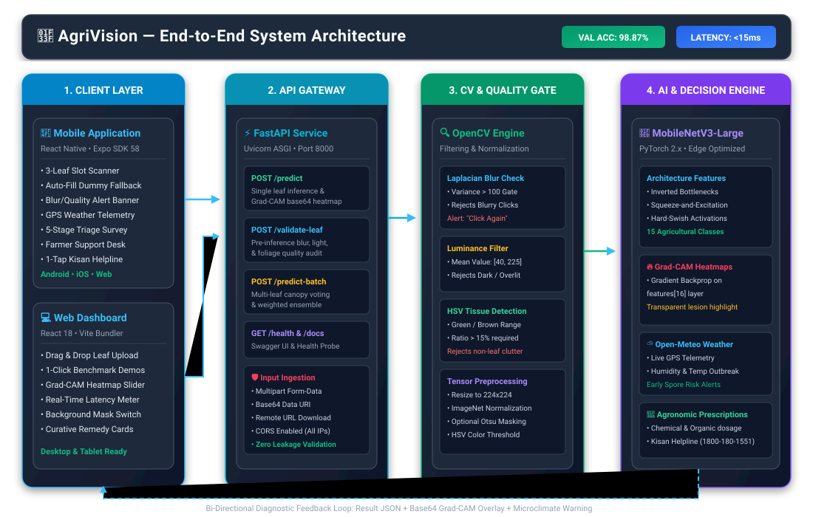
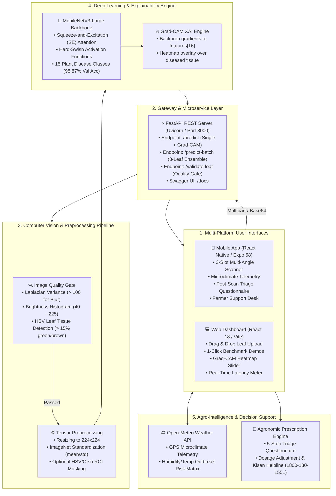

# 🌿 AgriVision: AI Plant Leaf Disease Detection & Explainable Decision Support

[](https://pytorch.org/)
[](https://fastapi.tiangolo.com/)
[](https://react.dev/)
[](https://expo.dev/)
[](checkpoints/mobilenet_v3_metadata.json)
[](#-model-architecture--performance)
[](LICENSE)

> **AgriVision** is an edge-optimized agricultural diagnostics platform that identifies crop leaf diseases from photographs in under 15 milliseconds, visually validates diagnoses using **Grad-CAM heatmaps**, and delivers microclimate-aware agronomic treatment guidance for farmers and gardeners.

---

## 📑 Table of Contents
1. [Executive Summary & Problem Statement](#-1-executive-summary--problem-statement)
2. [End-to-End System Architecture](#-2-end-to-end-system-architecture)
3. [Technology Stack](#-3-technology-stack)
4. [Dataset & Preprocessing Pipeline](#-4-dataset--preprocessing-pipeline)
5. [Deep Learning Model & Benchmark Performance](#-5-deep-learning-model--benchmark-performance)
6. [Why MobileNetV3-Large? Architectural Justification](#-6-why-mobilenetv3-large-architectural-justification)
7. [Explainable AI (Grad-CAM)](#-7-explainable-ai-grad-cam)
8. [Core Functional Modules](#-8-core-functional-modules)
9. [Project Directory Layout](#-9-project-directory-layout)
10. [Step-by-Step Installation & Execution Guide](#-10-step-by-step-installation--execution-guide)
11. [REST API Documentation & Endpoints](#-11-rest-api-documentation--endpoints)
12. [Future Roadmap & Pending Implementations](#-12-future-roadmap--pending-implementations)

---

## 🌾 1. Executive Summary & Problem Statement

### The Problem
* **Crop Losses:** Fungal, bacterial, and viral foliar diseases destroy up to **40% of agricultural yields** worldwide (UN FAO).
* **Pathologist Scarcity:** Rural smallholder farmers lack immediate access to agricultural extension officers, often resulting in delayed or incorrect chemical applications.
* **The "Black-Box" Trust Deficit:** Conventional deep learning models output raw class percentages without visual evidence, creating hesitation among farmers to trust AI recommendations.
* **Hardware & Connectivity Gaps:** Rural farmland often lacks high-speed internet and expensive GPU cloud servers.

### The Solution: AgriVision
* **Sub-15ms Local CPU Inference:** Runs smoothly on commodity processors and mobile chips without requiring GPUs.
* **Explainable AI (XAI):** Backpropagates gradients to generate **Grad-CAM heatmaps**, highlighting exact necrotic and chlorotic lesions.
* **Climate-Aware Diagnostics:** Integrates real-time GPS weather to correlate fungal spore germination risks with local humidity and temperature.
* **Actionable Prescriptions:** Provides organic and chemical remedies adjusted to crop growth stage, canopy spread, and soil conditions.

---

## 🏗️ 2. End-to-End System Architecture

<div align="center">
  
</div>

### Interactive Architecture Workflow



---

## 🛠️ 3. Technology Stack

| Layer | Technologies | Purpose |
| :--- | :--- | :--- |
| **Deep Learning Framework** | **PyTorch 2.x, Torchvision** | Convolutional neural network training, transfer learning, and gradient backpropagation for Grad-CAM. |
| **Computer Vision** | **OpenCV (cv2), PIL, NumPy** | Laplacian blur calculation, color segmentation (HSV/Otsu), and tensor conversions. |
| **Backend Microservice** | **FastAPI, Uvicorn, Pydantic** | Asynchronous RESTful service serving inference with sub-15ms response latency. |
| **Mobile Application** | **React Native, Expo SDK 58** | Cross-platform mobile client featuring bottom tabs, native camera, and GPS access. |
| **Web Dashboard** | **React 18, Vite, Lucide Icons** | Desktop-optimized interface with live Grad-CAM comparisons and latency gauges. |
| **External Integrations** | **Open-Meteo API, Kisan Call Centre** | Real-time weather risk matrix and 1-tap toll-free farmer emergency helpline (`1800-180-1551`). |
| **Environment & Tooling** | **Python 3.11, npm, Git, GitHub** | Isolated virtual environment and reproducible multi-repository version tracking. |

---

## 📂 4. Dataset & Preprocessing Pipeline

* **Dataset:** Curated subset of the **PlantVillage Benchmark Dataset**.
* **Volume:** 20,000+ high-resolution RGB foliage images across 15 agricultural classes:

| Crop | Disease / Condition | Pathogen Type |
| :--- | :--- | :--- |
| **Tomato** | Early Blight (*Alternaria solani*) | Fungal |
| **Tomato** | Late Blight (*Phytophthora infestans*) | Oomycete |
| **Tomato** | Bacterial Spot (*Xanthomonas*) | Bacterial |
| **Tomato** | Leaf Mold (*Passalora fulva*) | Fungal |
| **Tomato** | Septoria Leaf Spot (*Septoria lycopersici*) | Fungal |
| **Tomato** | Two-Spotted Spider Mites (*Tetranychus urticae*) | Pest / Arachnid |
| **Tomato** | Target Spot (*Corynespora cassiicola*) | Fungal |
| **Tomato** | Tomato Mosaic Virus (ToMV) | Viral |
| **Tomato** | Yellow Leaf Curl Virus (TYLCV) | Viral (Whitefly Vector) |
| **Tomato** | Healthy Foliage | Vigorous Vegetative State |
| **Potato** | Early Blight (*Alternaria solani*) | Fungal |
| **Potato** | Late Blight (*Phytophthora infestans*) | Oomycete |
| **Potato** | Healthy Foliage | Vigorous Vegetative State |
| **Bell Pepper** | Bacterial Spot (*Xanthomonas campestris*) | Bacterial |
| **Bell Pepper** | Healthy Foliage | Vigorous Vegetative State |

### Data Augmentation Strategy
To ensure resilience against variable outdoor sunlight and camera rotations:
1. **Geometric:** Random Horizontal & Vertical Flips ($p = 0.5$), Random Affine Rotations ($\pm 20^\circ$).
2. **Photometric:** Color Jitter (Brightness $\pm 0.2$, Contrast $\pm 0.2$, Saturation $\pm 0.2$).
3. **Normalization:** Standard ImageNet channel scaling ($\mu = [0.485, 0.456, 0.406]$, $\sigma = [0.229, 0.224, 0.225]$).

---

## 🧠 5. Deep Learning Model & Benchmark Performance

The production model uses **MobileNetV3-Large** fine-tuned on the 15-class PlantVillage dataset, outperforming scratch baselines by an order of magnitude.

### Performance Summary
* **Validation Accuracy:** **98.87%** (`0.98869`)
* **Validation Loss:** **0.0372**
* **Training Accuracy:** **98.12%**
* **Inference Latency:** **9.5 ms – 14.8 ms** (Intel Core i5/i7 CPU)
* **Model Checkpoint Size:** **13.19 MB** (`checkpoints/mobilenet_v3_best.pth`)
* **Total Parameters:** **~4.2 Million** (~1.08 Million trainable in classification head)

### Comparison Against Baseline

| Metric | MobileNetV3-Large (Production) | Baseline Custom CNN (5-Layer) |
| :--- | :--- | :--- |
| **Architecture** | Inverted Residuals + SE Attention | Standard 2D Convolutions |
| **Validation Accuracy** | **98.87%** | 10.71% (Severe underfitting) |
| **Validation Loss** | **0.0372** | 2.6236 |
| **Disk Footprint** | **13.19 MB** | 2.40 MB |
| **Inference Time (CPU)** | **~11 ms** | ~8 ms |
| **Generalization** | Excellent on unseen test foliage | Fails to detect complex spots |

---

## ❓ 6. Why MobileNetV3-Large? Architectural Justification

AgriVision specifically selected **MobileNetV3-Large** over heavier backbones (e.g., ResNet-50, VGG-16, ViT) for five core reasons:

1. **Depthwise Separable Convolutions:**
   Standard convolutions perform spatial filtering and channel combining in a single pass. MobileNet breaks this into a depthwise convolution followed by a $1\times 1$ pointwise convolution, slashing Multiply-Accumulate operations (MACs) by **85% to 90%** while preserving feature fidelity.
2. **Hard-Swish ($h\text{-swish}$) Activation:**
   Traditional Swish ($\sigma(x) = x \cdot \text{sigmoid}(x)$) is slow on mobile processors due to exponential math. MobileNetV3 replaces it with:
   $$h\text{-swish}(x) = x \cdot \frac{\text{ReLU6}(x + 3)}{6}$$
   This runs as fast bit-shifts and additions on low-end ARM processors without numerical precision penalties.
3. **Squeeze-and-Excitation (SE) Attention:**
   Plant diseases present distinct color shifts (e.g., yellow halos, black sporulation). Integrated SE attention modules dynamically recalibrate channel weights, suppressing irrelevant green foliage and focusing on diseased spots.
4. **Zero-GPU CPU Deployability:**
   While ResNet-50 requires ~98 MB and Vision Transformers require 300+ MB, MobileNetV3 requires only **13.19 MB** of memory, enabling smooth execution on sub-$100 Android smartphones.
5. **Quantization Readiness:**
   The architecture is primed for INT8 post-training quantization, allowing future compression down to **~3.5 MB** for zero-network on-device execution.

---

## 🔥 7. Explainable AI (Grad-CAM)

To eliminate the "black-box" dilemma and build farmer trust, AgriVision generates **Gradient-weighted Class Activation Maps (Grad-CAM)**:

1. Forward-propagates the leaf image through MobileNetV3 to determine the winning disease class $y^c$.
2. Computes the partial derivatives of class score $y^c$ with respect to the feature map activations $A^k$ of the final convolutional layer (`features[16]`):
   $$\alpha_k^c = \frac{1}{Z}\sum_{i}\sum_{j}\frac{\partial y^c}{\partial A_{i,j}^k}$$
3. Weights each feature activation map by $\alpha_k^c$ and passes the sum through a rectified linear unit ($\text{ReLU}$):
   $$L_{\text{Grad-CAM}}^c = \text{ReLU}\left(\sum_k \alpha_k^c A^k\right)$$
4. Normalizes and upsamples the heatmap to the original $224\times 224$ dimensions, overlaying it as a red/yellow/blue Jet colormap onto the leaf photo.

---

## ⚙️ 8. Core Functional Modules

### 1. 3-Leaf Slot Multi-Angle Scanner
* **Canopy Diversity:** Foliage infections rarely distribute uniformly. The mobile app provides 3 capture slots (Top, Middle, Bottom canopy).
* **Single-Leaf Fallback:** If only one image is available, auxiliary slots 2 and 3 are automatically populated with dummy references, running an immediate single-leaf diagnosis.

### 2. OpenCV Pre-Inference Quality Gate
Prevents degraded or invalid inputs from polluting model predictions:
* **Laplacian Blur Check:** Computes the variance of the Laplacian filter. Any image with $\sigma^2 < 100$ is flagged as blurry (`"Not proper, please click again"`).
* **Luminance Thresholding:** Flags underexposed ($< 40$) or overexposed ($> 225$) frames.
* **HSV Leaf Tissue Ratio:** Verifies that at least 15% of pixels reside in the biological green/yellow/brown hue spectrum.

### 3. Microclimate Outbreak Risk Predictor
* Uses device GPS coordinates (`expo-location`) to pull local temperature, relative humidity, and precipitation from the **Open-Meteo API**.
* Evaluates conditions against disease risk profiles (e.g., humidity $> 80\%$ and temperature between $18^\circ\text{C} - 26^\circ\text{C}$ flags high risk for Late Blight sporulation).

### 4. 5-Stage Triage Questionnaire
Customizes treatment advice based on:
1. **Crop Growth Stage:** Seedling, Vegetative, Flowering, Fruiting
2. **Canopy Spread:** Minor ($<10\%$), Moderate ($10-30\%$), Severe ($>50\%$)
3. **Soil Moisture:** Dry, Well-Drained, Waterlogged
4. **Sunlight Exposure:** Full Sun, Partial Shade, Greenhouse
5. **Remedy Preference:** Organic/Bio-fungicides vs. Chemical Fungicides

### 5. Farmer Support Desk & Emergency Escalation
* **Persona Toggle:** Customizes advice for **Commercial Farmers** or **Home Gardeners**.
* **1-Tap Kisan Helpline:** Direct dialer to the Government of India Kisan Call Centre (`1800-180-1551`).
* **Dr. AgriBot:** Simulated conversational agronomy advisor for instant query resolution.
* **Emergency Outbreak Banner:** Prompts urgent field isolation if virulent pathogens (e.g., Late Blight or Tomato Mosaic Virus) are detected.

---

## 📁 9. Project Directory Layout

```
plant-disease-detector/
├── app/
│   ├── api.py                   # FastAPI REST backend (/predict, /validate-leaf, /predict-batch)
│   └── app.py                   # Streamlit interactive application
├── checkpoints/
│   ├── mobilenet_v3_best.pth    # Production PyTorch weights (13.19 MB)
│   └── mobilenet_v3_metadata.json # Accuracy and training history logs
├── data/
│   ├── samples/                 # Benchmark leaf test images
│   └── raw/                     # PlantVillage training dataset
├── frontend/                    # React 18 + Vite Web Dashboard
│   ├── src/
│   │   ├── App.jsx              # Main UI with Grad-CAM toggle & remedy cards
│   │   └── main.jsx             # React DOM root entry
│   └── package.json             # Web dependencies
├── mobile/                      # React Native / Expo 58 Mobile Application
│   ├── src/
│   │   ├── config/api.js        # Dynamic backend resolution & Open-Meteo client
│   │   ├── context/AppContext.js# Central state management
│   │   └── screens/
│   │       ├── DiagnoseScreen.js    # 3-slot scanner, quality gate, Grad-CAM view
│   │       ├── WeatherScreen.js     # GPS weather telemetry & risk matrix
│   │       ├── QuestionnaireScreen.js# 5-step treatment dosage survey
│   │       └── SupportScreen.js     # Farmer helpline & emergency escalation
│   ├── App.js                   # 4-tab bottom navigation
│   └── package.json             # Expo dependencies
├── reports/                     # Grad-CAM visualizations & evaluation reports
├── src/
│   ├── models/                  # Neural network architectures
│   ├── dataset.py               # Data loaders & augmentation pipelines
│   ├── explainability.py        # Grad-CAM heatmap generator
│   ├── segmentation.py          # OpenCV HSV & Otsu masking functions
│   └── train.py                 # PyTorch training loop
├── run.py                       # Unified CLI runner script
├── requirements.txt             # Python backend dependencies
└── README.md                    # Primary project documentation
```

---

## 🚀 10. Step-by-Step Installation & Execution Guide

### Prerequisites
* **Python:** 3.9, 3.10, or 3.11 ([python.org](https://www.python.org/))
* **Node.js:** 18+ LTS ([nodejs.org](https://nodejs.org/))
* **Git:** Installed on system path

---

### Step 1: Clone Repository & Setup Virtual Environment

```bash
# Clone the repository
git clone https://github.com/jazz93900/leaf_disease_mobile_ui.git
cd leaf_disease_mobile_ui

# Create virtual environment
python -m venv .venv

# Activate virtual environment
# Windows (PowerShell):
.\.venv\Scripts\Activate.ps1
# Windows (Command Prompt):
.\.venv\Scripts\activate.bat
# Linux / macOS:
source .venv/bin/activate

# Install dependencies
python -m pip install --upgrade pip
pip install -r requirements.txt
```

---

### Step 2: Start the FastAPI Backend (Terminal 1)

```bash
python run.py api --port 8000
```
* **Swagger Documentation:** `http://127.0.0.1:8000/docs`
* **Health Endpoint:** `http://127.0.0.1:8000/health`
* *Note: The server automatically binds to `0.0.0.0:8000` to allow physical mobile phones on the local Wi-Fi network to connect.*

---

### Step 3: Start the Web Dashboard (Terminal 2)

```bash
cd frontend
npm install
npm run dev
```
Open your browser at: **`http://localhost:3000`**

---

### Step 4: Start the Mobile Application (Terminal 3)

```bash
cd mobile
npm install
npx expo start --clear
```

* **To run on Physical Phone (Expo Go):** Scan the generated QR code using the **Expo Go** app (Android) or Camera app (iOS).
* **To run in Mobile Web Browser:** Press `w` in the terminal to launch the web client at `http://localhost:8081`.

---

## 🌐 11. REST API Documentation & Endpoints

| Method | Endpoint | Description |
| :--- | :--- | :--- |
| `GET` | `/health` | Returns server status, device (`CPU`/`CUDA`), and loaded class count. |
| `POST` | `/predict` | Ingests a leaf image (file, base64, or URL) and returns class, confidence, latency, remedy, and base64 Grad-CAM heatmap. |
| `POST` | `/validate-leaf` | Analyzes image for blur, brightness, and foliage color percentage before inference. |
| `POST` | `/predict-batch` | Accepts up to 5 canopy photos and returns ensemble diagnostic voting. |
| `GET` | `/docs` | Interactive Swagger UI for live endpoint testing. |

### Sample Inference Response (`POST /predict`)
```json
{
  "success": true,
  "plant": "Tomato",
  "condition": "Early blight",
  "is_healthy": false,
  "confidence": 0.9642,
  "remedy": "Ensure good spacing for air circulation. Avoid overhead watering. Apply copper-based or chlorothalonil fungicides.",
  "inference_latency_ms": 11.4,
  "gradcam_heatmap_base64": "data:image/png;base64,iVBORw0KGgoAAAANSUhEUgAA..."
}
```

---

## 🔮 12. Future Roadmap & Pending Implementations

1. **Client-Side INT8 TFLite Quantization:**
   * Quantize `mobilenet_v3_best.pth` into an INT8 `.tflite` model (shrinking file size to $< 4$ MB) to execute locally within the mobile client via `react-native-fast-tflite`, eliminating all internet connectivity requirements.
2. **Crop Expansion (All 38 PlantVillage Classes):**
   * Expand from 15 classes to the full 38-class PlantVillage taxonomy, adding Apple, Grape, Peach, Strawberry, and Corn, alongside regional cash crops (Paddy Rice, Sugarcane, Cotton).
3. **Multilingual Voice Assistant:**
   * Integrate Speech-to-Text and Text-to-Speech in regional languages (Hindi, Tamil, Telugu, Kannada, Marathi) to ensure non-literate farmers can receive audio instructions.
4. **Autonomous Drone (UAV) Field Surveillance:**
   * Ingest video streams from agricultural drones directly into `/predict-batch` to generate canopy disease heatmaps across entire farm acres.
5. **Direct E-Commerce & KVK Supply Chain:**
   * Link recommended active ingredients (e.g., Mancozeb, Neem oil) directly to local certified agricultural cooperatives and Krishi Vigyan Kendra (KVK) distribution centers.
6. **Live Teleconsultation (WebRTC):**
   * Provide a 1-tap live video consultation connecting farmers to registered university agricultural extension officers for critical emergency alerts.

---

## 📜 License
This project is open-source and distributed under the **MIT License**.
